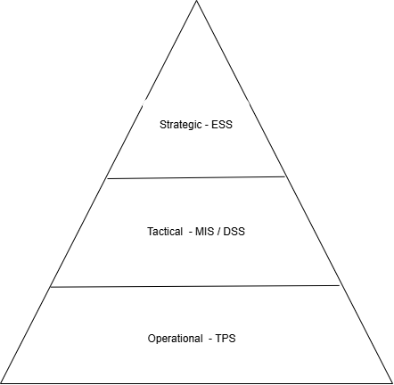

Tier 1: Operational Level - TPS

->Management Level: Operational
->Corresponding IS Type: TPS (Transaction Processing System)
->Data Flow & Purpose: Processes daily transaction data such as sales and orders to support routine decisions.

Tier 2: Tactical Level - MIS / DSS

->Management Level: Tactical
->Corresponding IS Type: MIS / DSS (Management Information System / Decision Support System)
->Data Flow & Purpose: Summarises TPS data into reports and trends to support planning and performance monitoring.

Tier 3: Strategic Level - ESS

->Management Level: Strategic
->Corresponding IS Type: ESS (Executive Support System)
->Data Flow & Purpose: Combines summarised internal and external data to support long-term decisions on company direction.

PART 2

IT Infrastructure Diagram: This diagram shows the physical equipment a company owns, like servers, computers, routers and cables. It also shows where each device is and how they are connected. IT technicians use it to set up and fix the hardware.

IT Landscape Diagram: This diagram shows the kinds of IT assets a company has at a logical level, such as applications, databases and services. It is different from the infrastructure diagram because it does not show the actual devices or cables. It gives a simple overview of which systems exist and how they work together.

IT Architecture Diagram: This diagram explains the concepts, norms and standards that guide how IT is built and used in a company. This includes design rules, security and data standards, and the technologies the company has approved. It helps keep all systems consistent and working toward the same business goals.

